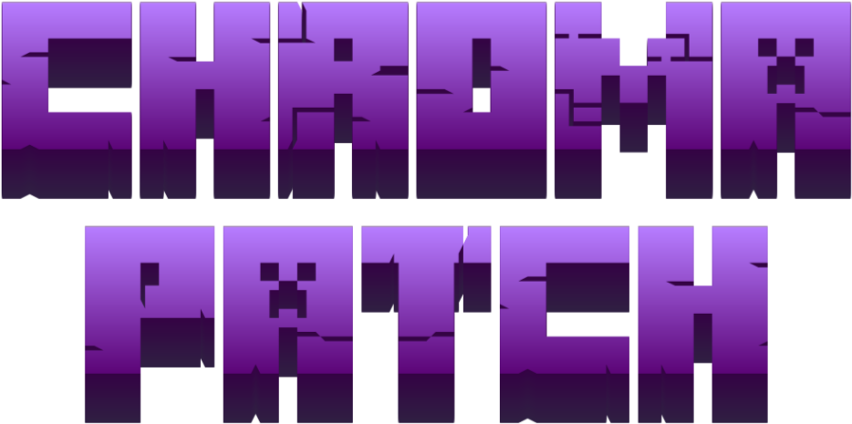
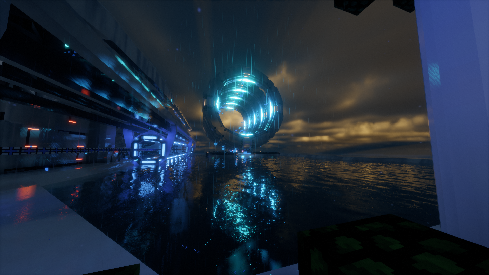
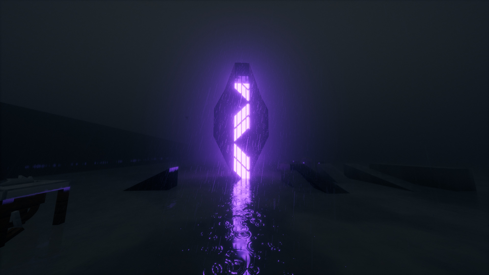
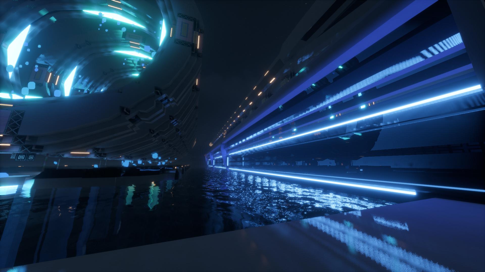
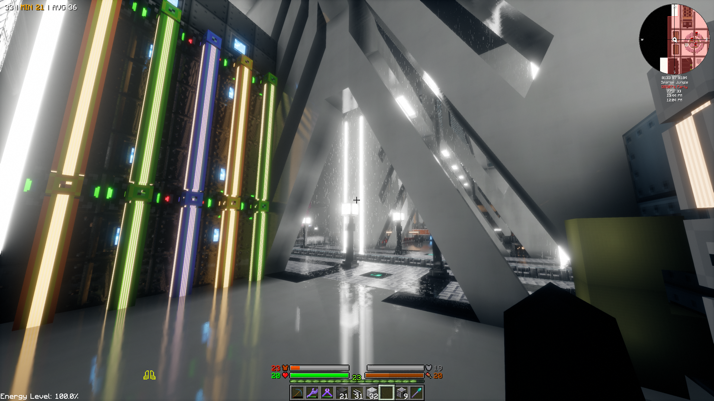
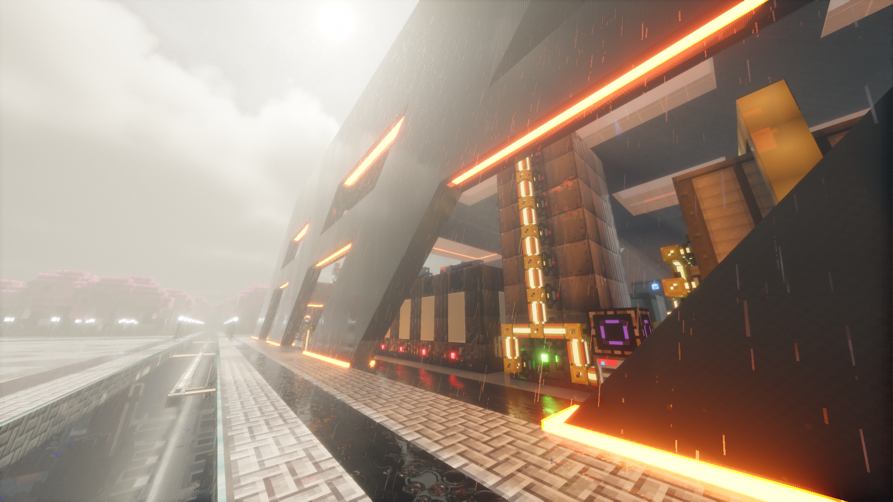
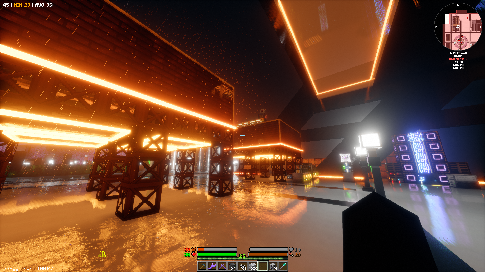

<p align="center">
  
</p>

<p align="center">
  
</p>

<p align="center">
  <a href="https://github.com/Summxx/ChromaPatch/releases">Latest release</a> |
  <a href="LICENSE.txt">License</a> |
  <a href="#roadmap">Roadmap</a> |
  <a href="#contributing">Contributing</a> |
  <a href="https://discord.gg/ZgXeQqePy3">Discord</a>
</p>

<div align="center">
  <a href="https://github.com/Summxx/ChromaPatch/releases">
    
  </a>
  
  
  <a href="https://discord.gg/ZgXeQqePy3">
    
  </a>
</div>

---

# About

Chroma Patch is the OBS07 edit of the **Eclipse** shader, distributed as a mod.

Edited versions of Eclipse cannot be redistributed, so the edit is applied locally. Eclipse is downloaded from its official page, and at startup the mod writes a patched copy next to it in `shaderpacks/`. The original zip is not modified.

The edit adds an atmosphere pass (lit night fog, godrays, dust, lamp light wells) and support for modded builds: microblocks, coloured lamps, GregTech glowing blocks, A Port Needed shapes and glass.

> [!NOTE]
> Chroma Patch is an unofficial edit, not affiliated with or endorsed by the Eclipse authors. **Eclipse is not included in the mod.** The patch is applied to the copy downloaded by the user.

### Credits

- **[Eclipse](https://github.com/Merlin1809/Eclipse-Shader)** by Merlin1809, based on Chocapic13's work.
- **Eclipse edit (KuraEdit)** by Kurama75, including the coloured candle light, Chisel antiblocks and GregTech coil colours.
- **OBS07** for the atmosphere, the modded block support and the mod.

---

# Installation

1. Install **Forge** (1.7.10 or 1.20.1) or **NeoForge** (1.21.1) with a shader mod: **Angelica** on GTNH, **Oculus** on Forge 1.20.1, **Iris** on NeoForge 1.21.1.
2. Put the **Chroma Patch** jar for your version in `mods/`.
3. Download **Eclipse** from its [official GitHub page](https://github.com/Merlin1809/Eclipse-Shader) (Code > Download ZIP) and put the zip in `shaderpacks/`, without extracting it.
4. Start the game. **`Eclipse-Shader KuraEdit [OBS07-Chroma Patch].zip`** is created in `shaderpacks/`. On the first launch, a welcome page on the title screen shows whether the patch was applied and what it adds.
5. Select it in the shader menu, then a preset in the profile list (see [Presets](#presets)).

Patching takes a few seconds on the first launch and only runs again when the Eclipse zip or the patch changes. To update Eclipse, add the new zip to `shaderpacks/` and restart: the newest Eclipse zip is used.

---

# Features

### Lamp-lit night fog

Night fog takes the colour of nearby lamps and moves with the wind. Moonlight and building shadows are visible in it.



### Neon glow

Neon blocks glow in their own colour and light the area around them: NeonCraft bars and letters on 1.20.1, Chisel neonite and froglight, Extra Utilities lightgems and other glowing decoration blocks on GTNH. The glow is saturated and reflects on wet ground and water.



### Coloured light from modded lamps

ProjectRed lamps, A Port Needed lamps and coloured candles emit light in their own colour. Blocks that glow only through a resource pack (neon strips, modded lamps) also light their surroundings.



### GregTech and microblocks

Glowing GregTech blocks in GTNH (coils, machines) emit the matching colour. CodeChicken microblocks have correct face shading, and lit microblocks emit light.

### Rain, godrays and dust

Rain only wets surfaces exposed to the sky. Godrays appear at sunrise and sunset, tinted by stained glass, with dust in the light.



### Lamp light wells and glass

Recessed microblock lamps add a beam or a glow in the fog above them. A Port Needed shapes let coloured light through, its tinted glass behaves like stained glass, and dark glass lets some sunlight through.



All new settings are in the **Atmosphere** page of the shader options. Each effect can be reduced or disabled.

### Presets

| Preset | Description |
| --- | --- |
| **OBS07 Ultimate** | Full quality, all settings at their defaults. Also restores the base settings after using another preset. |
| **OBS07 Normal** | Reduced clouds, shadows and reflections |
| **OBS07 Normal (No Fog)** | Normal without night fog and light wells |
| **OBS07 Performance** | For lower-end GPUs and large bases |
| **OBS07 Performance (No Fog)** | Performance without night fog and light wells |

---

# Requirements

## Minecraft

| Version | Loader | Shader mod |
| --- | --- | --- |
| 1.7.10 (GT New Horizons) | Forge | Angelica |
| 1.20.1 | Forge | Oculus |
| 1.21.1 | NeoForge | Iris |

## Shader

The official **Eclipse** zip. The patch targets Eclipse Unstable 3c18afc (September 2026) and tolerates small changes in newer ones. When a version differs too much, no pack is written and a `.log` file lists the parts that could not be applied.

---

# Updates

New patches and patch updates come with new versions of the mod. To update, download the new jar from the official pages and replace the old one in `mods/`.

On first launch the mod asks for permission to check GitHub for new versions. If refused, the mod never connects to the network. If allowed, the title screen shows a notice when a new version exists, with its changelog. OK opens the release page (after a confirmation), and the notice can be skipped for that version. Nothing is downloaded or installed by the mod.

Setting: `updates=ask|on|off` in `config/chromapatch.properties`.

## Security

- The mod never downloads code, patch data or jars. The only files read online are a version notice and its signature.
- The notice is signed and verified against the public key included in the mod. A modified notice is rejected, whether it was changed in transit or on GitHub. Older notices are rejected.
- The only host contacted is `raw.githubusercontent.com` (this repository), over HTTPS, and only after permission. No user data is sent.
- Patch data is included in the jar and can only write shader files inside the patched pack in `shaderpacks/`. Worlds, mods and the Eclipse zip are not modified.
- Malformed or oversized files are rejected without stopping the game. This applies to every zip in `shaderpacks/` (size limits on all reads, no partial pack written).
- Output file names are restricted to plain names, including names reserved by Windows.
- GitHub Actions only uses official actions pinned to a fixed commit, with read-only access except for publishing releases.

The source code is public. Release jars are built from it by GitHub Actions, with their hashes in `SHA256SUMS`. Download the mod from the official pages only.

---

# Roadmap

### Automatic light block detection
At load time the mod will scan every block in the modpack, detect light-emitting blocks and compute their colour from their texture. Modded lamps will then emit coloured light without hand-made block lists, in any modpack. 1.20.1 and 1.21.1 first, then 1.7.10.

### More shaders
Patches for other shaders, using the same method: the shader is downloaded from its authors and the mod applies the changes. New patches come with new versions of the mod.
- **Complementary**
- **Photon**

### Patch maintenance
Support for new Eclipse versions, fixes and improvements to the existing effects, delivered with new versions of the mod.

---

# Known Issues

* A much newer Eclipse version may not be supported until a new version of the mod. The `.log` file in `shaderpacks/` lists the parts that failed.
* On Windows the previous patched pack can stay locked while the game runs. Restart the game if the log reports it.
* Eclipse packs that already contain the OBS07 edit are skipped.

---

# Contributing

Missing glowing blocks or wrong colours can be added with a pull request to [`contrib/eclipse-blocks.txt`](contrib/eclipse-blocks.txt). Add a comment line with your name and what the edit adds, then the block ids sorted by colour:

```
# YourName: Chisel antiblocks
white: chisel:antiBlock:0 chisel:antiBlock:8
orange: chisel:antiBlock:1
```

Accepted additions are included in the patch of the next release, and contributors are credited. Eclipse files cannot be posted, so only block ids go in pull requests. For other changes, open an issue or ask on [Discord](https://discord.gg/ZgXeQqePy3).

By opening a pull request, you agree that your contribution is included in Chroma Patch under its [license](LICENSE.txt).

---

# Changelog

The same changelog is shown in game: once after each new version, and in the new version notice.

<!-- changelog -->

### Chroma Patch 1.0.0
- First release for Forge 1.7.10, Forge 1.20.1 and NeoForge 1.21.1
- Applies the OBS07 edit to the official Eclipse zip in shaderpacks
- Optional new version notice, disabled until allowed in game. The mod never downloads anything else
- Changelog shown in game after each new version
- Welcome page on first launch: patch result, what the patch adds, Discord link

### Eclipse patch 1.0.0
- Atmosphere page: lamp-lit night fog, godrays, dust, lamp light wells, glass light
- Neon blocks glow in their colour and light their surroundings
- Coloured light for ProjectRed, A Port Needed and coloured candle lamps
- GTNH glowing blocks sorted by colour, including Chisel antiblocks and GregTech coils
- CodeChicken microblock shading and light
- A Port Needed shapes let coloured light through, tinted glass works like stained glass
- Rain only wets surfaces exposed to the sky
- Presets: OBS07 Ultimate, Normal and Performance, with or without fog

<!-- /changelog -->

---

# License

All Rights Reserved, see [LICENSE.txt](LICENSE.txt). The source code is public for transparency.

Building and verifying a release: [MAINTAINING.md](MAINTAINING.md).
